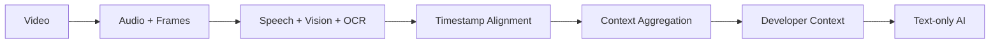

# OpenContext

**Turn video into context for text-only AI.**

OpenContext ingests video, splits it into audio and frames, transcribes speech,
applies vision and OCR to the visuals, aligns everything on a shared timeline,
and produces structured developer context that text-only AI models can consume.

## Pipeline



`Video → Audio + Frames → Speech + Vision + OCR → Timestamp Alignment → Context Aggregation → Developer Context → Text-only AI`

## Status

**The public web app is live on Vercel:** [opencontext-swart.vercel.app](https://opencontext-swart.vercel.app).
The repository includes the authenticated web app, video upload and job APIs,
results viewer, and Python media-processing worker. Evidence references in the
developer context link claims to a source timestamp and certainty label; they
are clickable in the results viewer and included in JSON exports. The current
production deployment serves the landing page, demo, docs, and sign-in screen.
The GitHub repository is connected to Vercel, and pushes to `main` create
production deployments.
GitHub OAuth, a persistent production database, object storage, and the
processor worker still need production configuration before real uploads can
be processed. See [`docs/swarm/STATE.md`](docs/swarm/STATE.md) for the remaining
release work.

## Quick start

Prerequisites: Node.js 20+ (24 recommended), npm 10+, Python 3.13+, and
FFmpeg available on `PATH` for the worker.

### Docker: full web, worker, and Postgres stack

The fastest path uses no provider credentials and starts the web app, worker,
and PostgreSQL with a local-only sign-in identity:

```bash
npm run fixture
docker compose up --build
```

Open <http://localhost:3000/auth/signin>, choose **Continue as local user**, and
upload `.artifacts/opencontext-fixture.mp4`. The Compose worker uses
`faster_whisper` with the `tiny.en` model for local speech recognition and a
deterministic fixture provider for visual observations. The fixture provider is
clearly labeled: it does not perform computer vision. `DEV_AUTH_ENABLED=true` is
set only by Compose; keep it disabled on public deployments.

### Native development

```bash
# 1. Install all workspace dependencies
npm install

# 2. Start the web app (http://localhost:3000)
npm run dev

# 3. Worker (separate terminal)
cd workers/processor
python -m venv .venv
.venv/Scripts/python -m pip install -e ".[dev,local]"     # Windows
# macOS/Linux: .venv/bin/python -m pip install -e ".[dev,local]"
.venv/Scripts/python -m oc_worker.main                  # Windows
# macOS/Linux: .venv/bin/python -m oc_worker.main
.venv/Scripts/python -m pytest
```

For native development, copy `.env.example` to `.env` and set
`DEV_AUTH_ENABLED=true`, `WORKER_API_TOKEN`, `TRANSCRIPTION_PROVIDER`,
`VISION_PROVIDER`, and `STORAGE_PATH` as needed. `faster_whisper` runs locally
after downloading a model; `ollama` can run local vision; `fixture` providers
produce offline deterministic test output and must not be presented as real AI
analysis.

## Development checks

```bash
npm run lint
npm run typecheck
npm test          # web unit/integration tests
npm run build

# worker
cd workers/processor
.venv/Scripts/python -m ruff check src tests
.venv/Scripts/python -m pytest
```

`npm test` includes a cross-language contract test and, when Python and FFmpeg
are available, a generated-video end-to-end test that uploads through the jobs
API, claims the queued job, runs the worker over HTTP, persists transcript,
observations, OCR, evidence, Markdown, and JSON, and checks the stored media
artifacts.

## Environment variables

Copy `.env.example` to the repository root as `.env` and to `apps/web/.env.local`
for Next.js. The landing page and demo need no credentials. Real uploads need
GitHub OAuth and the matching `WORKER_API_TOKEN`; model credentials depend on
the providers you choose. SQLite and local storage are the development defaults.

| Variable | Purpose | Default |
| --- | --- | --- |
| `DATABASE_URL` | Database connection string | SQLite file (`file:./dev.db`) |
| `STORAGE_PROVIDER` | Media storage backend: `local` or `s3` | `local` |
| `S3_ENDPOINT` | S3-compatible endpoint (used when `STORAGE_PROVIDER=s3`) | — |
| `S3_BUCKET` | Bucket for media objects | — |
| `S3_REGION` | Region for S3-compatible storage | — |
| `S3_ACCESS_KEY_ID` | S3-compatible access key id | — |
| `S3_SECRET_ACCESS_KEY` | S3-compatible secret access key | — |
| `REDIS_URL` | Optional Redis URL (future queue backends) | unset (DB-backed queue) |
| `AUTH_SECRET` | Secret for signing sessions/tokens | — |
| `AUTH_GITHUB_ID` | GitHub OAuth app client id | — |
| `AUTH_GITHUB_SECRET` | GitHub OAuth app client secret | — |
| `WORKER_API_TOKEN` | Service-to-service token for the worker API | — |
| `TRANSCRIPTION_PROVIDER` | `faster_whisper` (local) or `openai_compatible` | `faster_whisper` |
| `TRANSCRIPTION_MODEL` | Model name for the transcription provider | `base` |
| `OPENAI_API_KEY` | API key for OpenAI-compatible providers | — |
| `OPENAI_BASE_URL` | Base URL for OpenAI-compatible providers | — |
| `VISION_PROVIDER` | `openai_compatible` or `ollama` (local) | `openai_compatible` |
| `VISION_MODEL` | Vision model name | — |
| `OLLAMA_BASE_URL` | Ollama server URL (used when `VISION_PROVIDER=ollama`) | `http://localhost:11434` |
| `TEXT_PROVIDER` | Provider for text-only AI steps | — |
| `TEXT_MODEL` | Model name for text-only AI steps | — |
| `NEXT_PUBLIC_APP_URL` | Public URL of the web app (exposed to the browser) | `http://localhost:3000` |

## Architecture

| Component | Technology | Notes |
| --- | --- | --- |
| `apps/web` | Next.js (App Router, TypeScript, Tailwind CSS) | Web application |
| `packages/schemas` | TypeScript + Zod | Shared job/status schemas and pipeline constants |
| `packages/config` | TypeScript | Environment access helpers |
| `workers/processor` | Python 3.13 | FFmpeg extraction, transcription, frame analysis, aggregation, and context generation |

- **Storage abstraction**: local filesystem for dev; S3-compatible object
  storage for production parity.
- **Data layer**: SQLite for local dev; PostgreSQL via Prisma for production
  parity (see `docker-compose.yml` for optional services).
- **Queue**: database-backed in dev; Redis is optional and unused today.

## Evidence-first output

Extracted claims are paired with an evidence ID, source time, and certainty
label (`Observed`, `Inferred`, or `Uncertain`). In the results viewer, select
an evidence marker to seek the source video when playback is available;
Markdown exports retain readable timestamps, and JSON exports include the
evidence ledger. Timeline ranges are also clickable. Interactions are always
labeled as inferred. Owners can confirm or flag claims and attach notes or
suggested corrections; review metadata is included in both exports while the
original extracted claim remains available.

## Project status

Implementation is present in the working tree and the public web app is
deployed. See
[`docs/swarm/STATE.md`](docs/swarm/STATE.md) for the current release checklist
and [`docs/research/agent-ready-video-context.md`](docs/research/agent-ready-video-context.md)
for the product research behind evidence-linked output.

## License

[MIT](./LICENSE) — Copyright (c) 2026 OpenContext contributors.
