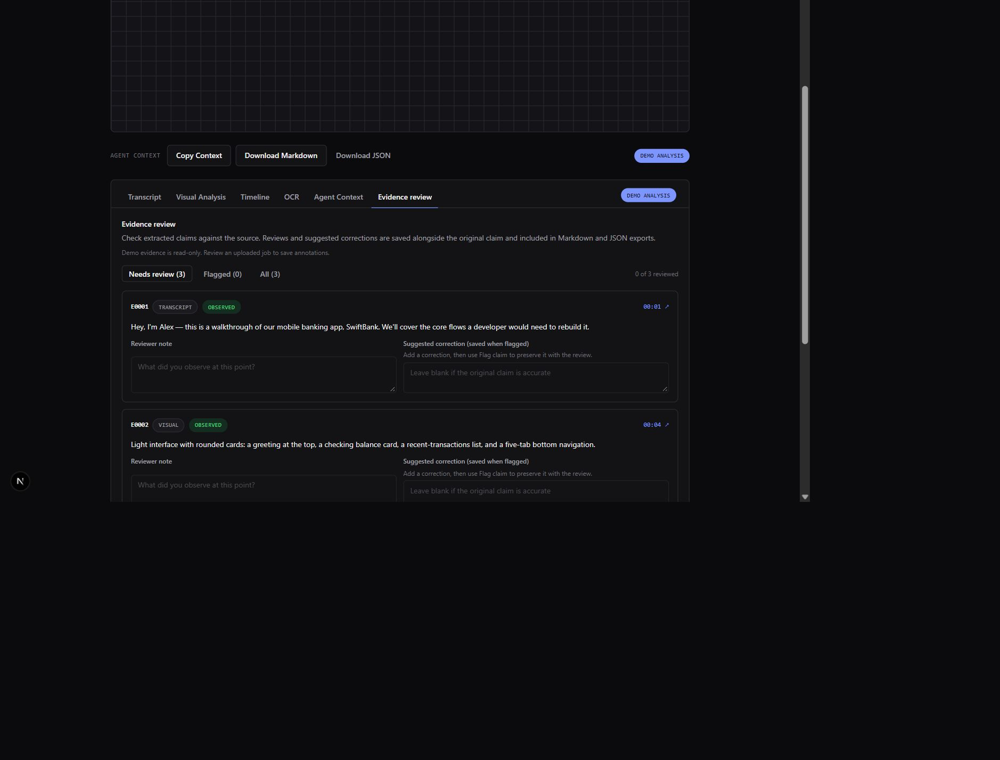

# OpenContext

[](https://github.com/kylosonic/opencontext/actions/workflows/ci.yml)
[](LICENSE)

**Video context for text-only AI.**

Text-only models and coding agents cannot inspect a screen recording. OpenContext
extracts speech, frames, visible text, UI elements, interactions, and state
changes, then returns a structured developer handoff where every claim links to
a source timestamp and certainty label.

## Start locally

Three commands to start a credential-free web, worker, and PostgreSQL stack:

```bash
npm run fixture
docker compose up --build
# open http://localhost:3000/auth/signin
```

Choose **Continue as local user** and upload
`.artifacts/opencontext-fixture.mp4`. The Compose worker uses local Faster
Whisper and a deterministic fixture provider for visual observations. The
default fixture is a three-second test pattern with a 440 Hz tone, so speech
recognition runs but correctly reports that no speech was found. The fixture
provider is labeled as fixture output; it does not perform computer vision.

To exercise speech transcription, record a short clip or build a video from the
attributed Harvard recording with `node scripts/generate-hearing-evaluation-video.mjs`.

For native Node/Python setup, use [CONTRIBUTING.md](CONTRIBUTING.md).



## Real fixture output

This excerpt was generated by the offline CLI from the synthetic fixture video.
It demonstrates the output contract, not model quality:

```markdown
## Timeline

- `[00:00-00:03]` **Fixture scene** — Deterministic fixture observation at 0.0s (no vision model used). (inferred)

## Transcript

- `[00:00-00:01]` This synthetic fixture demonstrates OpenContext evidence links without claiming speech-model output. [E0001 · 00:00 · Observed]

## Visible Text

- OpenContext fixture [E0004 · 00:00 · Uncertain]
- OpenContext fixture [E0005 · 00:00 · Observed]
```

Complete output:
[Markdown](docs/examples/opencontext-fixture.md) ·
[JSON](docs/examples/opencontext-fixture.json)

Regenerate it:

```bash
npm run fixture
opencontext analyze .artifacts/opencontext-fixture.mp4 --offline \
  --out context.md --json context.json
```

## What works

- Authenticated jobs, owner checks, job list/detail, retry, delete, and evidence
  review.
- Direct upload intents with presigned S3 `PUT` support and local-disk
  development storage.
- Explicit size/MIME validation, worker-token authentication, rate limits,
  retention cleanup, and tested FFmpeg argument handling.
- Upload cancellation with temporary-object cleanup and immediate retry.
- Memory or shared database rate limiting for single or multi-instance web
  deployments, with multi-process PostgreSQL contention coverage.
- Database-backed queue and resumable worker stages.
- Faster Whisper, OpenAI-compatible transcription, multimodal audio-chat,
  OpenAI-compatible vision, Ollama, and deterministic fixture providers.
- Independently selectable Tesseract OCR or vision-derived OCR compatibility.
- Evidence-linked Markdown and JSON with transcript, visual, OCR, timeline, and
  human-review metadata.
- Generated-video end-to-end test from upload through worker output.
- Real S3-compatible presigned upload/download coverage in CI.
- OpenCode Go hosted vision smoke and measured synthetic UI/OCR evidence with
  published context, scores, configuration, and limitations.
- Standalone `opencontext analyze`, `brief`, `replay`, `evaluate`, and `doctor` CLI
  workflows with release-ready shared schemas.
- Repository-aware implementation briefs and a local MCP server that expose
  evidence-linked video context directly to coding agents.
- Keyboard-tested result tabs, timeline seeking, and evidence labels.

## What is not ready

- The public worker drains the queue from a five-minute GitHub Actions schedule,
  so job start latency is up to one interval. A long-running container host is
  the recommended next step for sustained traffic.
- Published measured quality covers one simple synthetic visual flow and one
  clean attributed speech recording. It does not establish broad real-world vision
  or speech accuracy.
- Docker Compose is verified through a real upload and completed
  PostgreSQL-backed web/worker job in CI.
- Python and npm packages have not been published.
- A broader real-world evaluation set with conversational speech, noisy
  recordings, and dense UI remains pending.
- The default demo fixture has no audio track, so the production smoke job
  exercised vision, OCR, aggregation, and exports; use a speech recording to
  exercise transcription.
- No independent penetration test has been performed.

Current verification and remaining work:
[docs/status.md](docs/status.md) ·
[ROADMAP.md](ROADMAP.md)

## How it works

1. The browser creates an upload intent and uploads directly to object storage.
2. The server verifies object size and MIME type, then creates a queued job.
3. The worker claims the job and probes the source with FFmpeg.
4. Audio becomes timestamped transcript segments; frames become visual/OCR rows.
5. Aggregation creates a chronological timeline.
6. Context generation emits evidence-linked Markdown and JSON.

```text
Video → Upload intent → Object storage → Queue → FFmpeg → Speech/Vision/OCR
      → Timeline → Evidence ledger → Markdown + JSON
```

## Installable packages

The worker includes a standalone CLI:

```bash
python -m pip install "workers/processor[local]"
opencontext analyze video.mp4 --out context.md --json context.json
```

`@opencontext/schemas` builds to publishable ESM and declarations. Both artifacts
are release-ready in the source tree but not published. See
[docs/installable-packages.md](docs/installable-packages.md) and
[docs/releasing.md](docs/releasing.md).

Coding agents can use the local MCP server or generate a repository-aware brief
from an existing result. See
[docs/agent-integration.md](docs/agent-integration.md).

## Development checks

```bash
npm run lint
npm run typecheck
npm test
npm run build

cd workers/processor
.venv/Scripts/python -m ruff check src tests
.venv/Scripts/python -m pytest
```

`npm test` includes a cross-language contract test and a generated-video
end-to-end test that exercises direct upload, queue claim, worker HTTP calls,
FFmpeg extraction, provider output, evidence persistence, and exports.

## Architecture

| Path | Responsibility |
| --- | --- |
| `apps/web` | Next.js UI, auth, jobs, uploads, worker API, storage adapters |
| `packages/schemas` | Shared Zod contracts and publishable npm package |
| `packages/config` | Environment/provider helpers |
| `workers/processor` | Python worker, CLI, FFmpeg, providers, context export |
| `docs` | Behavior contracts, ADRs, deployment, security, issue drafts |

Configuration is documented in [.env.example](.env.example) and
[docs/deployment.md](docs/deployment.md). Never commit real credentials.

## Contributing and security

Read [CONTRIBUTING.md](CONTRIBUTING.md), the
[roadmap](ROADMAP.md), and the
[good first issue drafts](docs/issues/README.md).

Report vulnerabilities privately through [SECURITY.md](SECURITY.md), not a
public issue. The current security review is in
[docs/security-review.md](docs/security-review.md).

## License

[MIT](LICENSE) — Copyright (c) 2026 OpenContext contributors.
