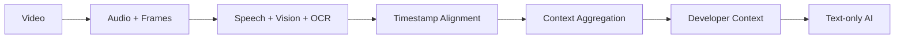

# OpenContext

**Turn video into context for text-only AI.**

OpenContext ingests video, splits it into audio and frames, transcribes speech,
applies vision and OCR to the visuals, aligns everything on a shared timeline,
and produces structured developer context that text-only AI models can consume.

## Pipeline



`Video → Audio + Frames → Speech + Vision + OCR → Timestamp Alignment → Context Aggregation → Developer Context → Text-only AI`

## Status

**MVP in active development.** The pipeline above is the target architecture;
components land incrementally in later slices. What exists today is the
repository scaffold, shared schemas, and CI.

## Quick start

Prerequisites: Node.js 20+ (24 recommended), npm 10+, Python 3.13+.

```bash
# 1. Install all workspace dependencies
npm install

# 2. Start the web app (http://localhost:3000)
npm run dev

# 3. Worker (separate terminal)
cd workers/processor
python -m venv .venv
.venv/Scripts/python -m pip install -e ".[dev]"     # Windows
# macOS/Linux: source .venv/bin/python -m pip install -e ".[dev]"
.venv/Scripts/python -m pytest
```

## Development checks

```bash
npm run lint
npm run typecheck
npm test          # no JS tests yet; the Python worker has pytest
npm run build

# worker
cd workers/processor
.venv/Scripts/python -m ruff check src tests
.venv/Scripts/python -m pytest
```

## Environment variables

Copy `.env.example` to `.env` (and `.env.local` for Next.js) and fill in values
as needed. Everything below is optional for local development; the defaults
run with SQLite and the local filesystem.

| Variable | Purpose | Default |
| --- | --- | --- |
| `DATABASE_URL` | Database connection string | SQLite file (`file:./dev.db`) |
| `STORAGE_PROVIDER` | Media storage backend: `local` or `s3` | `local` |
| `S3_ENDPOINT` | S3-compatible endpoint (used when `STORAGE_PROVIDER=s3`) | — |
| `S3_BUCKET` | Bucket for media objects | — |
| `S3_REGION` | Region for S3-compatible storage | — |
| `S3_ACCESS_KEY_ID` | S3-compatible access key id | — |
| `S3_SECRET_ACCESS_KEY` | S3-compatible secret access key | — |
| `REDIS_URL` | Optional Redis URL (future queue backends) | unset (DB-backed queue) |
| `AUTH_SECRET` | Secret for signing sessions/tokens | — |
| `AUTH_GITHUB_ID` | GitHub OAuth app client id | — |
| `AUTH_GITHUB_SECRET` | GitHub OAuth app client secret | — |
| `WORKER_API_TOKEN` | Service-to-service token for the worker API | — |
| `TRANSCRIPTION_PROVIDER` | `faster_whisper` (local) or `openai_compatible` | `faster_whisper` |
| `TRANSCRIPTION_MODEL` | Model name for the transcription provider | `base` |
| `OPENAI_API_KEY` | API key for OpenAI-compatible providers | — |
| `OPENAI_BASE_URL` | Base URL for OpenAI-compatible providers | — |
| `VISION_PROVIDER` | `openai_compatible` or `ollama` (local) | `openai_compatible` |
| `VISION_MODEL` | Vision model name | — |
| `OLLAMA_BASE_URL` | Ollama server URL (used when `VISION_PROVIDER=ollama`) | `http://localhost:11434` |
| `TEXT_PROVIDER` | Provider for text-only AI steps | — |
| `TEXT_MODEL` | Model name for text-only AI steps | — |
| `NEXT_PUBLIC_APP_URL` | Public URL of the web app (exposed to the browser) | `http://localhost:3000` |

## Architecture

| Component | Technology | Notes |
| --- | --- | --- |
| `apps/web` | Next.js (App Router, TypeScript, Tailwind CSS) | Web application |
| `packages/schemas` | TypeScript + Zod | Shared job/status schemas and pipeline constants |
| `packages/config` | TypeScript | Environment access helpers |
| `workers/processor` | Python 3.13 | Media processing worker (pipeline arrives in a later slice) |

- **Storage abstraction**: local filesystem for dev; S3-compatible object
  storage for production parity.
- **Data layer**: SQLite for local dev; Postgres via Prisma is planned for
  production parity (see `docker-compose.yml` for optional services).
- **Queue**: database-backed in dev; Redis is optional and unused today.

## License

[MIT](./LICENSE) — Copyright (c) 2026 OpenContext contributors.
