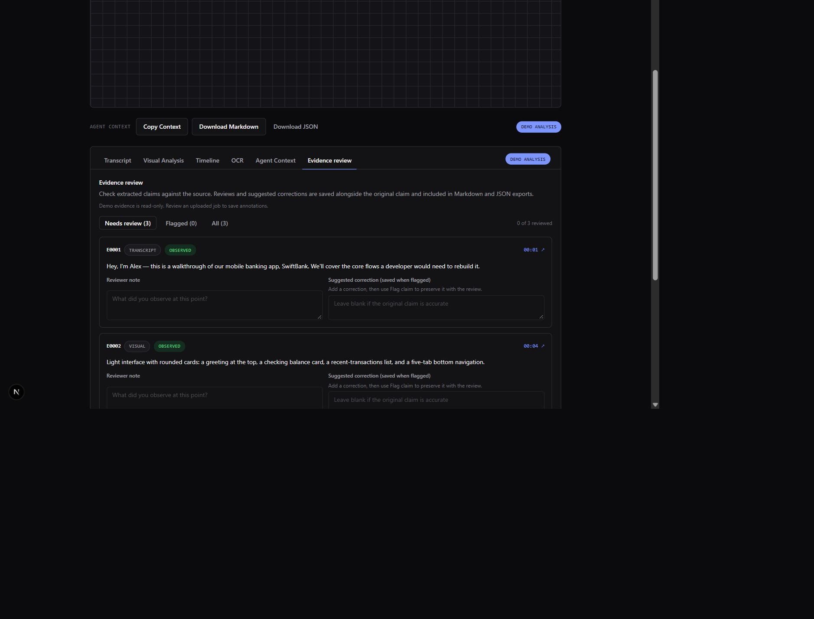

# OpenContext

[](https://github.com/kylosonic/opencontext/actions/workflows/ci.yml)
[](LICENSE)

**Visual context for text-only AI.**

Text-only models and coding agents cannot inspect a screen recording, audio
file, image, or PDF. OpenContext extracts speech, visual structure, visible
text, UI elements,
interactions, and state changes, then returns a structured developer handoff
where every claim links to source evidence and a certainty label.

## Start locally

Three commands to start a credential-free web, worker, and PostgreSQL stack:

```bash
npm run fixture
docker compose up --build
# open http://localhost:3000/auth/signin
```

Choose **Continue as local user** and upload
`.artifacts/opencontext-fixture.mp4`. The Compose worker uses local Faster
Whisper and a deterministic fixture provider for visual observations. The
default fixture is a three-second test pattern with a 440 Hz tone, so speech
recognition runs but correctly reports that no speech was found. The fixture
provider is labeled as fixture output; it does not perform computer vision.

To exercise speech transcription, record a short clip or build a video from the
attributed Harvard recording with `node scripts/generate-hearing-evaluation-video.mjs`.

### Optional real vision

The default Compose demo sends no image to a vision service and labels every
visual observation as fixture output. To inspect one real-model result, provide
an image-capable model and an OpenAI-compatible endpoint through your local
environment, then select real mode explicitly:

```bash
export OPENCONTEXT_DEMO_MODEL=your-image-capable-model
export OPENAI_BASE_URL=https://your-provider.example/v1
export OPENAI_API_KEY=...       # or OPENCODE_API_KEY
npm run compose:demo -- real
```

Real mode uses that model for visual analysis and the text summary. Upload
`docs/assets/real-vision-checkout.png` from the **Images** upload tab. It is a
generated, non-sensitive checkout mockup without an account or real payment
data. The image is sent to the configured service and may incur charges.
Recognition of its visible terms is a demonstration of this request only, not
evidence of general model accuracy.

`npm run compose:demo` without a configured endpoint starts the fixture mode.
On PowerShell, use `$env:OPENCONTEXT_DEMO_MODEL='your-model'` and the equivalent
environment syntax for the other variables.
An explicit real selection stops before use when a configuration variable is
missing. The launcher accepts local values from the ignored `.env.local` file
when present; it never prints credentials.

For native Node/Python setup, use [CONTRIBUTING.md](CONTRIBUTING.md).



## Real fixture output

This excerpt was generated by the offline CLI from the synthetic fixture video.
It demonstrates the output contract, not model quality:

```markdown
## Timeline

- `[00:00-00:03]` **Fixture scene** — Deterministic fixture observation at 0.0s (no vision model used). (inferred)

## Transcript

- `[00:00-00:01]` This synthetic fixture demonstrates OpenContext evidence links without claiming speech-model output. [E0001 · 00:00 · Observed]

## Visible Text

- OpenContext fixture [E0004 · 00:00 · Uncertain]
- OpenContext fixture [E0005 · 00:00 · Observed]
```

Complete output:
[Markdown](docs/examples/opencontext-fixture.md) ·
[JSON](docs/examples/opencontext-fixture.json)

Regenerate it:

```bash
npm run fixture
opencontext analyze .artifacts/opencontext-fixture.mp4 --offline \
  --out context.md --json context.json
```

## What works

- Authenticated jobs, owner checks, job list/detail, retry, delete, and evidence
  review.
- Team workspaces with existing-user membership by email or GitHub login.
  Personal jobs remain private; team jobs are available to every workspace
  member.
- Read-only public links with hashed bearer tokens, 30-day expiration, rotation,
  revocation, and a source stream scoped to the shared result.
- Direct upload intents with presigned S3 `PUT` support and local-disk
  development storage.
- PNG, JPEG, and WebP uploads support one image or an ordered set of up to 10.
  The server checks bytes, MIME type, format, and a 40-megapixel ceiling; the
  worker applies EXIF orientation, flattens transparency onto white, removes
  metadata, emits deterministic normalized JPEG, and adds cross-image changes
  to the context. Real-FFmpeg tests cover every EXIF orientation, all three
  formats, malformed inputs, metadata removal, and the pinned static FFmpeg CI
  path.
- PDFs up to 50 MB and 30 pages are rendered into ordered pages. Embedded text
  becomes OCR evidence and each rendered page follows the same vision,
  evidence, and export path as an image.
- Audio-only MP3, M4A, WAV, OGG, AAC, and FLAC uploads run the same transcription,
  evidence, duration-bound, and export pipeline without requiring a video track.
- Public URL import with DNS/IP SSRF rejection, pinned address resolution,
  redirect revalidation, Content-Length enforcement, byte caps, and stored-content
  validation.
- Live server-sent job updates with an automatic three-second polling fallback.
- Explicit size/MIME validation, worker-token authentication, rate limits,
  retention cleanup, and tested FFmpeg argument handling.
- Upload cancellation with temporary-object cleanup and immediate retry.
- Memory or shared database rate limiting for single or multi-instance web
  deployments, with multi-process PostgreSQL contention coverage.
- Database-backed queue and resumable worker stages.
- Faster Whisper, OpenAI-compatible transcription, multimodal audio-chat,
  OpenAI-compatible vision, native Gemini vision, Ollama, and deterministic
  fixture providers.
- Independently selectable Tesseract OCR or vision-derived OCR compatibility.
- Evidence-linked Markdown and JSON with transcript, visual, OCR, timeline, and
  human-review metadata.
- Idempotent analysis usage records with configurable resale prices,
  authenticated aggregation, and scheduled reconciliation for future metered
  billing.
- Generated-video end-to-end test from upload through worker output.
- Hybrid video sampling has an optional fail-open Python de-duplication pass.
  A reproducible synthetic benchmark retained every slide boundary while
  reducing modeled vision/OCR calls from 16 to 5; see
  [the measurements and limits](docs/performance/frame-dedup-2026-11-26.md).
- Audio-backed worker end-to-end test that transcribes the committed Harvard
  recording with real Faster Whisper in CI and checks transcript WER/CER and
  evidence timestamp bounds.
- Generated image-set and PDF jobs are covered from upload and batch commit
  through worker rendering, result persistence, and export data.
- Reproducible downloaded-media coverage verifies 11 JPEG/PNG/WebP images and
  two real MP4 videos through local analysis and replay; the HTTP/worker smoke
  accepts mixed 10-image sets, standalone images, and multiple videos.
- Real S3-compatible presigned upload/download coverage in CI.
- OpenCode Go hosted vision smoke and measured synthetic UI/OCR evidence with
  published context, scores, configuration, and limitations. The opt-in smoke
  also checks a generated checkout image through the full image pipeline.
- A held-out workflow covering 32 noisy far-field AMI conversational clips and
  16 real Screen2Words screenshots. The local Faster Whisper `tiny.en` pass
  measured 61.83% WER and 43.81% CER; real-world visual output is still awaiting
  a measured image-capable model run.
- Standalone `opencontext analyze`, `brief`, `replay`, `evaluate`, and `doctor` CLI
  workflows with release-ready shared schemas.
- Repository-aware implementation briefs and a local MCP server that expose
  evidence-linked video and image context directly to coding agents.
- Keyboard-tested result tabs, timeline seeking, and evidence labels.

## What is not ready

- The public worker drains the queue from a five-minute GitHub Actions schedule.
  An opt-in `job-queued` repository dispatch can wake it immediately; without
  that configuration, start latency remains up to one interval. A Render
  persistent-worker blueprint is checked in, but a live persistent host has not
  yet been verified.
- Quality evidence now includes noisy conversational speech and real app
  screenshots, but it is still a bounded smoke corpus. It does not establish
  broad production accuracy; the measured visual pass is not complete.
- Docker Compose is verified through a real upload and completed
  PostgreSQL-backed web/worker job in CI.
- The repository has a WAF preview/apply script and bounded PostgreSQL pool
  configuration, but production traffic tuning remains pending.
- The default demo fixture has no audio track, so the production smoke job
  exercised vision, OCR, aggregation, and exports; use a speech recording to
  exercise transcription.
- No independent penetration test has been performed.

- Usage accounting is implemented, but payment-provider integration, prices,
  tax policy, refunds, and customer-to-subscription mapping are intentionally not
  activated without product/owner decisions.

Current verification and remaining work:
[docs/status.md](docs/status.md) ·
[ROADMAP.md](ROADMAP.md)

## How it works

1. The browser creates an upload intent for video, audio, PDF, or an image set,
   or the server imports a validated public URL.
2. The server verifies object size and MIME type, then creates a queued job.
3. The worker claims the job and probes or renders the source with FFmpeg and
   PDFium.
4. Audio becomes timestamped transcript segments; frames, images, and PDF
   pages become visual/OCR rows.
5. Aggregation creates a chronological timeline.
6. Context generation emits evidence-linked Markdown and JSON.

```text
Video/audio/image/PDF → Upload intent → Object storage → Queue → FFmpeg/PDFium
                 → Speech/Vision/OCR → Timeline → Evidence ledger → Markdown + JSON
```

## Installable packages

The worker includes a standalone CLI:

```bash
python -m pip install "opencontext-video[local]==0.1.2"
opencontext analyze video.mp4 --out context.md --json context.json
opencontext analyze mockup.png --out image.md --json image.json
opencontext analyze reference.pdf --out pdf.md --json pdf.json
```

The Python package is published as `opencontext-video==0.1.2`. The TypeScript
contracts are available as `@kylosonic/opencontext-schemas@0.1.2` with ESM and
declarations. See
[docs/installable-packages.md](docs/installable-packages.md) and
[docs/releasing.md](docs/releasing.md).

Coding agents can use the local MCP server or generate a repository-aware brief
from an existing result. See
[docs/agent-integration.md](docs/agent-integration.md).

## Development checks

```bash
npm run lint
npm run typecheck
npm test
npm run build

cd workers/processor
.venv/Scripts/python -m ruff check src tests
.venv/Scripts/python -m pytest
```

`npm test` includes cross-language contract tests and generated media end-to-end
tests that exercise direct upload, queue claim, worker HTTP calls, FFmpeg and
PDFium extraction, provider output, evidence persistence, and exports. The
worker suite also contains an opt-in audio-backed test that runs real local
speech recognition against the attributed Harvard recording:

```bash
cd workers/processor
OPENCONTEXT_ASR_E2E=1 .venv/Scripts/python -m pytest tests/test_audio_e2e.py
```

The first run downloads the `tiny.en` model into the Hugging Face cache; CI
caches it and runs the test on every build.

## Architecture

| Path | Responsibility |
| --- | --- |
| `apps/web` | Next.js UI, auth, jobs, uploads, worker API, storage adapters |
| `packages/schemas` | Shared Zod contracts and publishable npm package |
| `packages/config` | Environment/provider helpers |
| `workers/processor` | Python worker, CLI, FFmpeg, providers, context export |
| `docs` | Behavior contracts, ADRs, deployment, security, issue drafts |

Configuration is documented in [.env.example](.env.example) and
[docs/deployment.md](docs/deployment.md). Module boundaries, request flows, and
common extension points are mapped in [docs/architecture.md](docs/architecture.md).
Never commit real credentials.

## Contributing and security

Read [CONTRIBUTING.md](CONTRIBUTING.md), the
[roadmap](ROADMAP.md), and the
[good first issue drafts](docs/issues/README.md).

Report vulnerabilities privately through [SECURITY.md](SECURITY.md), not a
public issue. The current security review is in
[docs/security-review.md](docs/security-review.md).

## License

[MIT](LICENSE) — Copyright (c) 2026 OpenContext contributors.
